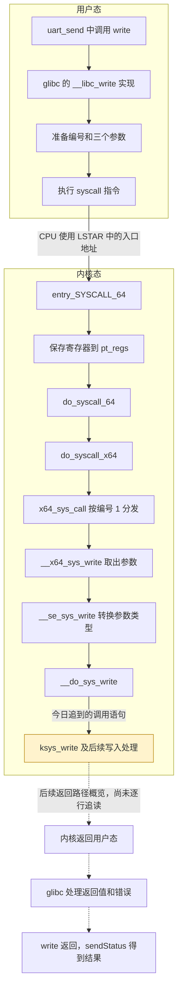
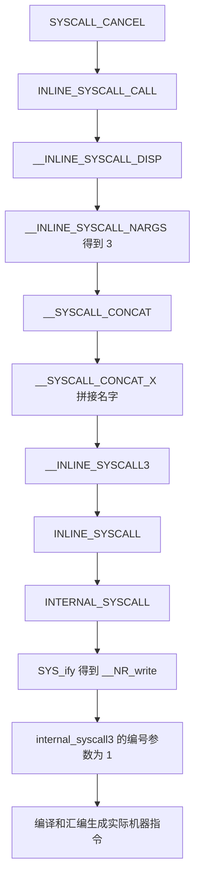
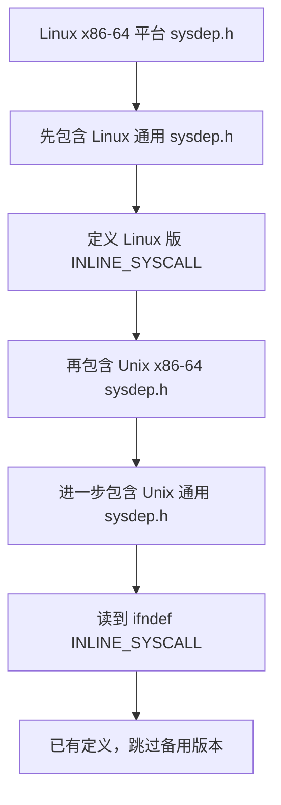
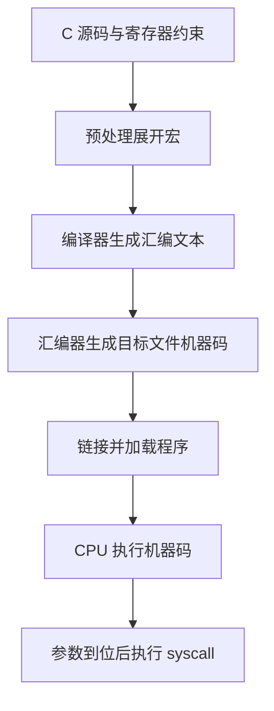
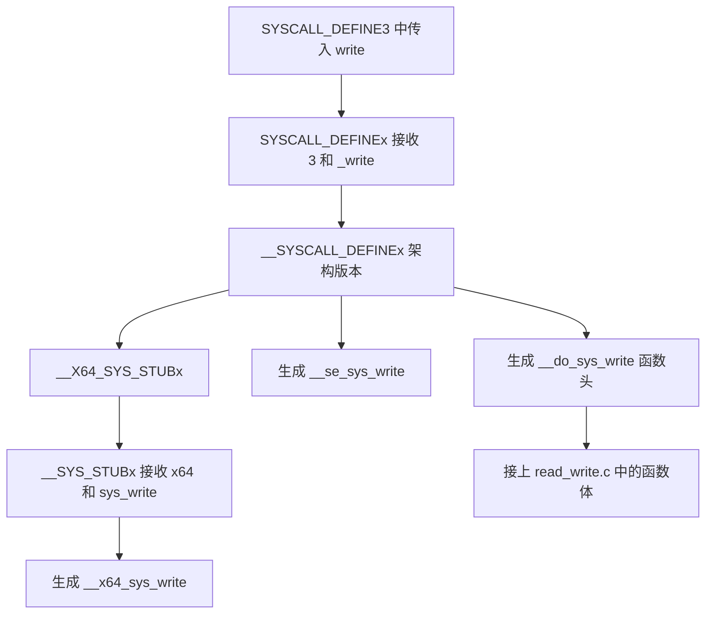

# 从 write 追到 __do_sys_write 的源码学习笔记

学习日期：2026 年 10 月 16 日。项目：UARTApp。

今天从 `uart.c` 中的一次 `write()` 出发，逐层展开 glibc 的宏，查看参数怎样进入寄存器、`syscall` 怎样进入内核，再追到内核生成的 `__x64_sys_write`、`__se_sys_write` 和 `__do_sys_write`。重点是每一层怎样接上下一层，以及阅读时容易混淆的地方。

**本次实际追到的终点是 `__do_sys_write` 中的 `return ksys_write(fd, buf, count);`。已经追通系统调用的入口，尚未逐行追完 `ksys_write` 后面的写入处理和返回路径。**

## 1 阅读环境和源码范围

| 项目 | 本次使用的内容 |
|---|---|
| 应用代码 | `E:\UARTApp`，WSL 路径 `/mnt/e/UARTApp` |
| glibc 源码 | `/home/yqr/glibc-src/usr/src/glibc/glibc-2.35/` |
| Linux 源码 | `/home/yqr/linux-src/usr/src/linux-source-6.5.0/` |
| 讨论的接口 | Linux x86-64 的普通 64 位系统调用接口 |
| 实验编译器 | WSL 中的 GCC 11.4.0 |
| 本机 C 库 | `getconf GNU_LIBC_VERSION` 显示 `glibc 2.35` |
| 当前运行的内核 | `uname -r` 显示 `6.18.54.1-microsoft-standard-WSL2` |

**正在阅读的 6.5.0 源码，不等于 WSL 当前运行的 6.18 内核。**下面的具体函数、行号和分发实现以本地 6.5.0 源码树为准，用来理解机制，不能当作当前 WSL 内核逐指令匹配的调试记录。本地源码还包含后续修改：其 x86-64 系统调用分发使用 `switch`，不能直接套用其他版本的 `sys_call_table[nr]` 调用方式。

系统调用编号也有适用范围。本文的 `__NR_write = 1` 对应 Linux x86-64 的普通 64 位接口，不能照搬到其他架构或兼容接口。

## 2 先把三种过程分开

读源码时最容易把“宏展开”“函数调用”“CPU 执行指令”混成同一件事。

| 过程 | 发生时间 | 具体例子 |
|---|---|---|
| 预处理 | 编译过程中 | 包含头文件、替换宏、通过 `##` 拼出 `__INLINE_SYSCALL3` |
| 编译和汇编 | 构建程序时 | 根据寄存器约束生成 `mov`，把汇编编码成机器码 |
| 实际执行 | 程序运行时 | CPU 执行 `syscall`，内核调用处理函数并返回 |

宏本身不会作为一个函数在运行时被调用。平时说“继续追这个宏”，是继续寻找它的定义，查看预处理后的代码是什么。宏生成的函数也可能被编译器内联，因此源码层次不保证每层都有独立的机器码 `call` 指令。

### 2.1 系统调用运行时流程

这张图表示正常路径上的运行关系。图中 `__libc_write` 包含宏展开后生成的指令；宏展开的细节另见第 5 节。



到达 `__do_sys_write` 时还没有完成写入。图中的最后三步说明什么才算调用结束，不表示今天已经读完这些实现。

## 3 起点是 uart.c 中的一次 write

位置：[uart.c 第 18 行](/mnt/e/UARTApp/uart.c:18)。

```c
sendStatus = write(fd, (const unsigned char *)buf + tmp, count - tmp);
```

这一轮传入的三个参数是：

| 参数 | 当前含义 |
|---|---|
| `fd` | 已经打开的设备对应的文件描述符 |
| `(const unsigned char *)buf + tmp` | 从已发送部分之后开始的数据地址 |
| `count - tmp` | 本轮还希望写入的字节数 |

把指针转换成 `unsigned char *` 后再加 `tmp`，这里是按字节移动地址。后面的笔记常用 `buf`、`nbytes` 简写，但实际传递的是本轮计算后的地址和剩余长度。

`uart_send()` 是项目自己的循环发送函数。`write()` 的实现由 C 库提供，`<unistd.h>` 让编译器知道它的声明。一次 `write()` 可能只写入一部分；应用根据返回值更新 `tmp`，必要时再发起下一次 `write()`。

## 4 为什么 write 的实现叫 __libc_write

位置：[glibc write.c 第 24 行](/home/yqr/glibc-src/usr/src/glibc/glibc-2.35/sysdeps/unix/sysv/linux/write.c:24)。函数体的关键语句是：

```c
return SYSCALL_CANCEL(write, fd, buf, nbytes);
```

后面则有：

```c
libc_hidden_def(__libc_write)
weak_alias(__libc_write, __write)
libc_hidden_weak(__write)
weak_alias(__libc_write, write)
libc_hidden_weak(write)
```

### 4.1 weak_alias 和 aliasname

`weak_alias(__libc_write, write)` 给已有实现增加一个弱别名 `write`。同一份实现可以有多个符号名字，不会因此再生成一个转发函数。

`aliasname` 只是宏参数名，不是一个需要另找实现的函数。在当前用法中，原名字 `name` 是 `__libc_write`，新名字 `aliasname` 是 `write`。

[libc-symbols.h 第 153–156 行](/home/yqr/glibc-src/usr/src/glibc/glibc-2.35/include/libc-symbols.h:153)：

```c
#define weak_alias(name, aliasname) _weak_alias(name, aliasname)
#define _weak_alias(name, aliasname) \
  extern __typeof(name) aliasname __attribute__((weak, alias(#name))) \
    __attribute_copy__(name);
```

逐项含义：

| 语法 | 在这里的作用 |
|---|---|
| 行尾 `\` | 将下一行继续接入同一条宏定义 |
| `extern` | 声明可供其他代码引用的函数名字；不表示实现必须在其他文件 |
| `__typeof(name)` | 获取原函数的完整类型，包括返回类型和参数类型；不是调用函数，也不是只取返回类型 |
| `aliasname` | 新名字，在本例中是 `write` |
| `__attribute__((...))` | GCC 扩展语法，给声明附加编译器属性 |
| `weak` | 把新名字标记成弱符号 |
| `alias(#name)` | 让新名字对应原符号的实现 |
| `#name` | 宏参数字符串化，把 `__libc_write` 变成字符串 `"__libc_write"` |
| `__attribute_copy__(name)` | 在支持时复制原声明的相关属性，不复制函数代码 |

替换外层参数后的声明主体是：

```c
extern __typeof(__libc_write) write
  __attribute__((weak, alias("__libc_write")))
  __attribute_copy__(__libc_write);
```

`__attribute_copy__` 还会继续展开。支持时使用 GCC 的 `copy` 属性；相关头文件未提供它或编译器不支持时，可以展开为空。它不负责复制 `weak`、`alias`、`visibility` 等链接或可见性属性，所以这些属性需要单独声明。

### 4.2 强定义和弱定义属于链接知识

符号是编译后的文件中用于标识函数、变量的名字。链接器将目标文件和库组合起来，并解析这些名字。

普通的、未标记 `weak` 的函数定义通常是强定义。弱定义也有可用的实现，但可以作为默认实现让位。

在通常的静态链接中，针对参与链接的同名定义：

| 定义情况 | 通常结果 |
|---|---|
| 只有一个强定义 | 使用它 |
| 只有一个弱定义 | 使用它 |
| 强定义与同名弱定义同时存在 | 使用强定义 |
| 两个同名强定义 | 报重复定义错误 |

这不是每次调用时临时比较“谁更强”。动态库装载的符号查找还有额外规则，不能把静态链接规则不加条件地套到所有动态链接情况。

本例中，`__libc_write` 是强定义；`write` 是弱别名。它们名字不同，不互相竞争。“强定义优先”讨论的是同名符号。

### 4.3 libc_hidden_def 隐藏的是什么

`libc_hidden_def` 与头文件里的 `libc_hidden_proto` 配合，在构建共享 libc 时安排内部隐藏名字，使库内部调用可以绑定到自己的实现，避开外部符号查找带来的中转或替换。

例如，内部使用的名字可以是 `__GI___libc_write`。公开入口 `write` 仍然可以被应用调用。这里的“隐藏”涉及符号可见性，不是把源代码隐藏，也不是让函数不执行。

依据：[libc-symbols.h 的内部调用说明](/home/yqr/glibc-src/usr/src/glibc/glibc-2.35/include/libc-symbols.h:455)、[include/unistd.h 中的声明](/home/yqr/glibc-src/usr/src/glibc/glibc-2.35/include/unistd.h:69)。

## 5 从 SYSCALL_CANCEL 展开到 INLINE_SYSCALL

### 5.1 SYSCALL_CANCEL 是宏

位置：[sysdeps/unix/sysdep.h 第 118 行](/home/yqr/glibc-src/usr/src/glibc/glibc-2.35/sysdeps/unix/sysdep.h:118)。

这个宏负责发起系统调用，并配合线程取消机制。`CANCEL` 指线程取消支持，不是取消当前写入。无需取消处理的路径直接使用 `INLINE_SYSCALL_CALL`；另一条路径先调整取消类型，调用后再恢复原状态。

当前关注的核心展开是：

```c
INLINE_SYSCALL_CALL(write, fd, buf, nbytes)
```

这里的 `write` 是用来拼接编号等内容的宏参数，不会再次调用用户态 `write()` 造成递归。

### 5.2 完整的宏展开路线

下面画的是预处理关系，不是 CPU 在运行时依次调用这些宏。



**INLINE 和 INTERNAL 是不同名字。**本例从 `SYSCALL_CANCEL` 先到 `INLINE_SYSCALL_CALL`，不是第 57 行的 `INTERNAL_SYSCALL_CALL`。后者使用相似的宏分发办法，但不能混入本次展开路线。

### 5.3 DISP 的参数 b 是什么

[第 100–109 行](/home/yqr/glibc-src/usr/src/glibc/glibc-2.35/sysdeps/unix/sysdep.h:100)的关键定义是：

```c
#define __INLINE_SYSCALL_DISP(b, ...) \
  __SYSCALL_CONCAT(b, __INLINE_SYSCALL_NARGS(__VA_ARGS__))(__VA_ARGS__)
#define INLINE_SYSCALL_CALL(...) \
  __INLINE_SYSCALL_DISP(__INLINE_SYSCALL, __VA_ARGS__)
```

本次参数对应：

| 占位名字 | 替换内容 |
|---|---|
| `b` | `__INLINE_SYSCALL`，待拼接的宏名前缀 |
| `__VA_ARGS__` | `write, fd, buf, nbytes` |

`b` 是普通宏参数名，不是 C 关键字，也不是运行时变量。

### 5.4 为什么不是拼成 __INLINE_SYSCALL__VA_ARGS__

`__SYSCALL_CONCAT` 的第二个参数是整个 `__INLINE_SYSCALL_NARGS(__VA_ARGS__)`，不是直接拼接 `__VA_ARGS__`。

计数结果先展开成 `3`，于是得到：

```c
__SYSCALL_CONCAT(__INLINE_SYSCALL, 3)
```

再使用[第 27–28 行](/home/yqr/glibc-src/usr/src/glibc/glibc-2.35/sysdeps/unix/sysdep.h:27)：

```c
#define __SYSCALL_CONCAT_X(a, b) a##b
#define __SYSCALL_CONCAT(a, b) __SYSCALL_CONCAT_X(a, b)
```

两层宏让参数先展开，再交给 `##` 拼接，结果是 `__INLINE_SYSCALL3`。原表达式末尾还有一组 `(__VA_ARGS__)`，它把原来的参数交给拼出来的宏，因此整体成为：

```c
__INLINE_SYSCALL3(write, fd, buf, nbytes)
```

前半部分选名字，最后的括号给选出的宏传参数。

## 6 参数数量为什么算出 3

这一步是参数位置选择，不是运行时计数函数。

[第 97–99 行](/home/yqr/glibc-src/usr/src/glibc/glibc-2.35/sysdeps/unix/sysdep.h:97)：

```c
#define __INLINE_SYSCALL_NARGS_X(a,b,c,d,e,f,g,h,n,...) n
#define __INLINE_SYSCALL_NARGS(...) \
  __INLINE_SYSCALL_NARGS_X(__VA_ARGS__,7,6,5,4,3,2,1,0,)
```

### 6.1 将本次参数代入

```c
__INLINE_SYSCALL_NARGS_X(write, fd, buf, nbytes, 7, 6, 5, 4, 3, 2, 1, 0,)
```

从左到右按位置对应：

| 位置 | 固定参数 | 本次收到的内容 |
|---|---|---|
| 1 | `a` | `write` |
| 2 | `b` | `fd` |
| 3 | `c` | `buf` |
| 4 | `d` | `nbytes` |
| 5 | `e` | `7` |
| 6 | `f` | `6` |
| 7 | `g` | `5` |
| 8 | `h` | `4` |
| 9 | `n` | `3` |

宏的替换内容只有 `n`，所以得到 `3`。后面的 `2,1,0` 和末尾空参数被 `...` 接收，本次不使用。

### 6.2 为什么选第 9 个位置并补上 7 到 0

这组宏提供 `__INLINE_SYSCALL0` 到 `__INLINE_SYSCALL7`，后缀表示不含系统调用名字的参数数量。

最多 7 个参数，加上 1 个名字，原始内容占 8 个位置。因此选择第 9 个位置，结果一定会落在补入的数字序列中。

| 实际系统调用参数数量 | 加上名字后占几位 | 第 9 位是补充序列的第几项 | 该项需要是什么 |
|---|---|---|---|
| 7 | 8 | 1 | `7` |
| 6 | 7 | 2 | `6` |
| 5 | 6 | 3 | `5` |
| 4 | 5 | 4 | `4` |
| 3 | 4 | 5 | `3` |
| 2 | 3 | 6 | `2` |
| 1 | 2 | 7 | `1` |
| 0 | 1 | 8 | `0` |

这就是补入 `7,6,5,4,3,2,1,0` 的具体原因。原来的参数每少一个，就会从补充序列中向后多取一项，结果也相应少一。

### 6.3 九个固定参数不等于最多只能接受九项

`NARGS_X` 有九个固定参数，后面还有 `...`，因此可以接收更多项；它只是固定取第九项。

但整套宏只提供后缀 `0` 到 `7`。传入超过范围的系统调用参数时，这套计数和选择规则不能正确工作。这是通用宏的选择范围，不表示 Linux x86-64 系统调用接口支持七个参数；该接口通常最多通过寄存器传递六个参数。

## 7 同名 INLINE_SYSCALL 为什么采用 Linux 版本

### 7.1 __INLINE_SYSCALL3 先明确传入参数数量

[通用 sysdep.h 第 86–87 行](/home/yqr/glibc-src/usr/src/glibc/glibc-2.35/sysdeps/unix/sysdep.h:86)：

```c
#define __INLINE_SYSCALL3(name, a1, a2, a3) \
  INLINE_SYSCALL(name, 3, a1, a2, a3)
```

本次得到：

```c
INLINE_SYSCALL(write, 3, fd, buf, nbytes)
```

这里 `nr = 3` 表示参数数量，不是系统调用编号。

### 7.2 通用文件确实还有一个备用定义

[同文件第 173–175 行](/home/yqr/glibc-src/usr/src/glibc/glibc-2.35/sysdeps/unix/sysdep.h:173)：

```c
#ifndef INLINE_SYSCALL
#define INLINE_SYSCALL(name, nr, args...) __syscall_##name(args)
#endif
```

如果采用这份定义，确实会拼成 `__syscall_write(...)`。关键在 `#ifndef`：只有 `INLINE_SYSCALL` 尚未定义时，里面的定义才生效。

### 7.3 实际包含顺序决定备用定义被跳过

Linux x86-64 的平台头文件先包含 Linux 通用层，再包含 Unix x86-64 层；后者进一步包含 Unix 通用层。



源码依据：[平台文件第 22–23 行](/home/yqr/glibc-src/usr/src/glibc/glibc-2.35/sysdeps/unix/sysv/linux/x86_64/sysdep.h:22)、[Unix x86-64 文件第 18 行](/home/yqr/glibc-src/usr/src/glibc/glibc-2.35/sysdeps/unix/x86_64/sysdep.h:18)。

因此使用的是 [Linux 通用文件第 41–48 行](/home/yqr/glibc-src/usr/src/glibc/glibc-2.35/sysdeps/unix/sysv/linux/sysdep.h:41)。其第一条关键语句是：

```c
long int sc_ret = INTERNAL_SYSCALL(name, nr, args);
```

本次代入：

```c
long int sc_ret = INTERNAL_SYSCALL(write, 3, fd, buf, nbytes);
```

**跨文件查定义不是运行时跳文件。**预处理器读取头文件后，宏定义在相应范围内生效；宏替换体中的其他宏，在实际使用、展开时继续解析，不必在写下外层 `#define` 的那一刻就全部展开。

`INLINE_SYSCALL` 在取得底层结果后，还负责判断内核错误返回，并转成 C 库的 `-1` 和 `errno`。本次先追它内部的 `INTERNAL_SYSCALL`。

## 8 从 INTERNAL_SYSCALL 到 internal_syscall3

当前平台采用 [Linux x86-64 sysdep.h 第 233–235 行](/home/yqr/glibc-src/usr/src/glibc/glibc-2.35/sysdeps/unix/sysv/linux/x86_64/sysdep.h:233)：

```c
#undef INTERNAL_SYSCALL
#define INTERNAL_SYSCALL(name, nr, args...) \
  internal_syscall##nr(SYS_ify(name), args)
```

`#undef` 取消此前可能存在的同名定义。代入后，`internal_syscall##3` 拼成小写的 `internal_syscall3`：

```c
internal_syscall3(SYS_ify(write), fd, buf, nbytes)
```

同文件[第 33–34 行](/home/yqr/glibc-src/usr/src/glibc/glibc-2.35/sysdeps/unix/sysv/linux/x86_64/sysdep.h:33)：

```c
#undef SYS_ify
#define SYS_ify(syscall_name) __NR_##syscall_name
```

所以 `SYS_ify(write)` 拼成 `__NR_write`，得到：

```c
internal_syscall3(__NR_write, fd, buf, nbytes)
```

### 8.1 怎样确认 __NR_write 是 1

本机 [unistd_64.h 第 5 行](/usr/include/x86_64-linux-gnu/asm/unistd_64.h:5)直接定义：

```c
#define __NR_write 1
```

内核的[编号表第 12 行](/home/yqr/linux-src/usr/src/linux-source-6.5.0/arch/x86/entry/syscalls/syscall_64.tbl:12)也记录：

```text
1    common    write    sys_write
```

编号是接口规定好的，不是根据函数名字临时计算，也不是每次调用动态分配。相同架构、相同接口必须保持兼容，否则旧程序会请求到错误的服务；不同架构或兼容接口的编号可以不同。

因此，本例最终采用：

```c
internal_syscall3(1, fd, buf, nbytes)
```

**后缀 `3` 是参数数量，括号中的 `1` 是系统调用编号。**

## 9 internal_syscall3 怎样准备和执行系统调用

位置：[x86-64 sysdep.h 第 283–299 行](/home/yqr/glibc-src/usr/src/glibc/glibc-2.35/sysdeps/unix/sysv/linux/x86_64/sysdep.h:283)。以下按原宏顺序拆解，不一次复制整个实现。

### 9.1 语句表达式和结果变量

宏使用 GNU C 的 `({ ... })` 形式。里面可以放声明和多条语句，最后一个表达式的值作为整体的值。

```c
unsigned long int resultvar;
```

这个变量用来接收内核返回到寄存器中的原始结果。宏末尾再以 `(long int) resultvar` 作为整体结果，保留 Linux 原始负错误码的含义，交给上一层处理。

### 9.2 TYPEFY 和 ARGIFY 准备临时值

```c
TYPEFY(arg3, __arg3) = ARGIFY(arg3);
TYPEFY(arg2, __arg2) = ARGIFY(arg2);
TYPEFY(arg1, __arg1) = ARGIFY(arg1);
```

本例分别保存 `nbytes`、`buf` 的地址值、`fd`。与之相关的定义是：

```c
#define TYPEFY1(X) __typeof__((X) - (X))
#define ARGIFY(X) ((TYPEFY1(X)) (X))
#define TYPEFY(X, name) __typeof__(ARGIFY(X)) name
```

`TYPEFY1` 借助表达式的类型，得到用于转换的整数类型；`ARGIFY` 执行相应的类型转换；`TYPEFY` 用转换后的类型声明变量。这里的 `__typeof__` 用来取得类型，不是为了先在运行时计算 `buf - buf` 再把地址变成零。

对本例中的 `int fd`，临时变量声明可理解为 `int __arg1 = fd;`。对指针 `buf`，转换后保存的是地址对应的整数值，不是复制缓冲区的数据内容。

### 9.3 指定输入参数使用的寄存器

```c
register TYPEFY(arg3, _a3) asm("rdx") = __arg3;
register TYPEFY(arg2, _a2) asm("rsi") = __arg2;
register TYPEFY(arg1, _a1) asm("rdi") = __arg1;
```

寄存器是 CPU 内部暂存数据的位置。这里声明 `_a1`、`_a2`、`_a3`，指定它们作为后续汇编操作数时使用哪些寄存器。

| C 变量 | 当前值 | 指定寄存器 |
|---|---|---|
| `_a1` | `fd` | `rdi` |
| `_a2` | 本轮待写入数据的地址值 | `rsi` |
| `_a3` | 本轮请求写入的字节数 | `rdx` |

这不是永久独占这些寄存器，也不能逐字理解成每条声明都必须立即生成一条搬运指令。它与下面的输入约束配合，要求执行内联汇编时值已经在正确的位置。

### 9.4 扩展汇编的四个部分

```c
asm volatile (
    "syscall\n\t"
    : "=a" (resultvar)
    : "0" (number), "r" (_a1), "r" (_a2), "r" (_a3)
    : "memory", REGISTERS_CLOBBERED_BY_SYSCALL);
```

| 部分 | 含义 |
|---|---|
| `"syscall\n\t"` | 汇编模板，实际指令为 `syscall`；换行和制表符只是排版 |
| 第一个冒号后 | 输出操作数说明 |
| 第二个冒号后 | 输入操作数说明 |
| 第三个冒号后 | 受影响的寄存器、标志或内存说明，称为 clobber list |

`asm` 表示在 C 代码中使用汇编。`volatile` 告诉编译器该汇编有副作用，不能仅因输出没有被使用就删掉它；它并不意味着所有周边代码都完全禁止移动，也不是线程同步机制。

**冒号后的内容是给编译器的约束，不是 CPU 从上到下或从下到上执行的语句。**因此没有“先执行 memory，再执行输入，再执行输出”的顺序。

### 9.5 为什么输出是 =a，输入却是 0

```c
: "=a" (resultvar)
: "0" (number), "r" (_a1), "r" (_a2), "r" (_a3)
```

`"=a"(resultvar)` 是第 0 个输出操作数：`=` 表示输出，`a` 在这里指定累加器寄存器 `rax`，将输出结果交给 `resultvar`。

`"0"(number)` 中的 `"0"` 是匹配约束，要求输入使用与第 0 个输出相同的位置。因此 `number` 也放进 `rax`。

**`"0"` 不是系统调用编号，也不是要传入数值零。`number` 的值才是编号，本例为 `1`。**

| 时刻 | `rax` 的用途 |
|---|---|
| 执行 `syscall` 前 | 放入系统调用编号 `1` |
| 内核返回后 | 放入系统调用返回值 |

`"r"(_a1)` 等说明这些值是寄存器输入，配合前面的局部寄存器变量声明，使三项分别使用 `rdi`、`rsi`、`rdx`。

### 9.6 memory、cc、r11、cx 各表示什么

同文件第 221 行：

```c
#define REGISTERS_CLOBBERED_BY_SYSCALL "cc", "r11", "cx"
```

| 名字 | 在这个列表里的含义 |
|---|---|
| `"memory"` | 汇编可能访问没有单独列为操作数的内存，例如 `buf` 指向的数据；编译器必须据此安排内存读写和优化 |
| `"cc"` | 条件码或条件标志可能被改变，不能假设以前的比较结果仍可直接复用 |
| `"r11"` | 告知编译器 `r11` 会被覆盖；`syscall` 会用它保存用户态标志状态 |
| `"cx"` | 在此标识被影响的 `rcx` 寄存器；`syscall` 会用它保存返回用户态的指令地址 |

`cc` 是 condition codes 的缩写，不是一个叫 `cc` 的普通通用寄存器。x86-64 的条件标志包含在 `RFLAGS` 中，例如零标志、进位标志、溢出标志。

`"memory"` 不会生成名为 `memory` 的机器指令，也不等同于一条 CPU 硬件内存屏障。它是编译器层面的约束。`"cx"` 在这里也不是只允许低 16 位被修改，而是告知 GCC 对应寄存器资源受影响。

### 9.7 真实的执行顺序

编译器根据声明和约束安排代码：先保证输入寄存器已准备好，然后执行 `syscall`，从内核回来后再使用 `rax` 中的输出。

| 项目 | 执行 `syscall` 前的内容 |
|---|---|
| `rax` | `1` |
| `rdi` | `fd` |
| `rsi` | `(const unsigned char *)buf + tmp` 的地址值 |
| `rdx` | `count - tmp` |

“输出说明”在源代码里写在“输入说明”前面，是 GCC 扩展汇编的格式要求，不是 CPU 的执行顺序。

## 10 从编译器说明到实际搬运指令

### 10.1 汇编与机器码是什么关系

编译器根据 C 代码和内联汇编约束生成汇编；汇编器把汇编编码成目标文件中的机器码；程序加载后，CPU 执行这些机器码。



`mov eax, 1` 是人可读的汇编表示；`b8 01 00 00 00` 是对应机器码字节的十六进制显示。CPU 执行字节，不会在运行时读取 C 宏或汇编文本。

### 10.2 今天实际编译的对照实验

实验提取了本地 glibc 的 `internal_syscall3` 及其依赖宏，放入一个仅转交三个参数的函数中，用 WSL 的 GCC 11.4.0 分别以 `-O0`、`-O2` 编译。这里只进行了编译和反汇编，没有执行实验中的写入系统调用，也不是重建了整套 glibc。

为避免依赖临时目录，结果已随笔记保存：

| 内容 | 文件 |
|---|---|
| 未优化的汇编文本 | [O0.s](evidence/2026-10-16-write-registers/O0.s) |
| 未优化的机器码与反汇编 | [O0.disasm.txt](evidence/2026-10-16-write-registers/O0.disasm.txt) |
| 优化后的汇编文本 | [O2.s](evidence/2026-10-16-write-registers/O2.s) |
| 优化后的机器码与反汇编 | [O2.disasm.txt](evidence/2026-10-16-write-registers/O2.disasm.txt) |

最初观察的路径是 `/tmp/write-register-study-afp03onl/`。这些文件是实验产生的对应结果，不是 `uart.c` 整个程序的反汇编，也不保证与安装的 libc 在每一个字节上相同。

### 10.3 O0 中能看到参数搬运

实际反汇编的关键部分如下，使用 Intel 写法，**目标在左，来源在右**：

```asm
mov rdx, QWORD PTR [rbp-0x8]
mov rsi, QWORD PTR [rbp-0x10]
mov edi, DWORD PTR [rbp-0x14]
mov eax, 0x1
syscall
```

`[rbp-偏移]` 表示本次编译用于存放临时变量的栈内存位置。`QWORD PTR` 表示读取 8 字节，`DWORD PTR` 表示读取 4 字节。

| 机器码 | 本例中的作用 |
|---|---|
| `48 8b 55 f8` | 将暂存的 `nbytes` 放入 `rdx` |
| `48 8b 75 f0` | 将暂存的 `buf` 地址值放入 `rsi` |
| `8b 7d ec` | 将暂存的 `fd` 放入 `edi` |
| `b8 01 00 00 00` | 将系统调用编号 `1` 放入 `eax` |
| `0f 05` | 执行 `syscall` |

`edi`、`eax` 分别是 `rdi`、`rax` 的低 32 位。x86-64 写入这些 32 位寄存器时会清零高 32 位，所以执行 `mov eax, 1` 后，整个 `rax` 的值为 `1`。

### 10.4 O2 为什么没有三个参数的搬运指令

同一个实验开启优化后，核心机器指令只剩：

```asm
mov eax, 1
syscall
ret
```

原因是这三个函数参数进入实验函数时，就已按普通 x86-64 C 调用约定位于相应的参数寄存器，符合本次系统调用的要求。编译器不需要先存到栈里再取回来，也不需要重复搬运。

本机 `/lib/x86_64-linux-gnu/libc.so.6` 的 `__write` 反汇编中，简单路径也能看到先设置 `eax = 1`，随后直接执行 `syscall`；涉及取消处理的另一条路径会保存、恢复参数。

因此，声明和约束要求的是“使用时值在正确位置”，不是“每条声明都必须对应一条独立的 `mov`”。

## 11 syscall 怎样进入 entry_SYSCALL_64

### 11.1 CPU 知道硬件规则，Linux 提供入口地址

CPU 不认识源码名字 `entry_SYSCALL_64`，也不会根据字符串 `write` 搜索内核函数。

x86-64 硬件规定，执行普通 64 位 `syscall` 指令时，使用专用寄存器 `LSTAR` 中设置的入口地址。Linux 在初始化时设置这个地址。

位置：[arch/x86/kernel/cpu/common.c 第 2069–2072 行](/home/yqr/linux-src/usr/src/linux-source-6.5.0/arch/x86/kernel/cpu/common.c:2069)，函数 `syscall_init()` 中：

```c
wrmsrl(MSR_LSTAR, (unsigned long)entry_SYSCALL_64);
```

`wrmsrl` 向指定的专用寄存器写入 64 位值；`MSR_LSTAR` 指定目标寄存器；后一个参数是内核入口地址。这一步在系统初始化时完成，在 UART 程序运行前已经准备好。

CPU 执行 `syscall` 时进行必要的执行状态切换，并把入口地址装入指令指针 `RIP`，从相应内存位置继续执行内核机器码。

| 位置 | 保存的东西 | 用途 |
|---|---|---|
| `LSTAR` | 内核入口地址 | 决定从哪里进入内核 |
| `rax` | 系统调用编号 `1` | 进入内核后，决定要处理哪项服务 |
| `rcx` | `syscall` 后下一条指令的地址 | 为返回用户态准备继续执行的位置 |
| `r11` | 用户态标志状态 | 为返回和状态处理提供记录 |

`read`、`write` 等请求可以先进入同一个入口，再由内核根据不同编号选择处理函数。

### 11.2 Linux 不会在运行时执行硬盘上的 entry_64.S 文件

`entry_64.S` 是源码，提前经过预处理和汇编生成 `entry_64.o`，随后链接进内核。系统启动时加载编译好的内核，运行时 CPU 根据内存地址执行其中的机器码。

[arch/x86/entry/Makefile 第 14 行](/home/yqr/linux-src/usr/src/linux-source-6.5.0/arch/x86/entry/Makefile:14)列出：

```make
obj-y := entry.o entry_$(BITS).o syscall_$(BITS).o
```

构建 64 位内核时，`entry_$(BITS).o` 对应 `entry_64.o`。CPU 不需要知道 `/home/yqr/linux-src/...` 这个目录，更不会在执行 `syscall` 时去打开 `.S` 源文件。

下载、编辑一份内核源码，不会自动替换正在运行的内核。这里尤其要记住第 1 节中本地源码版本与运行内核版本的区别。

## 12 entry_SYSCALL_64 怎样保存和转交参数

位置：[entry_64.S 第 87 行](/home/yqr/linux-src/usr/src/linux-source-6.5.0/arch/x86/entry/entry_64.S:87)：

```asm
SYM_CODE_START(entry_SYSCALL_64)
```

这标记入口机器码的位置。此时已经进入内核态，但仍是在为当前程序的这次调用服务，并非新建一个进程去执行源码。

### 12.1 内核入口代码切换栈并保存寄存器

入口先处理进入内核所需的环境切换，再使用内核栈。内核栈是内核执行时用于暂存数据的一块内存空间。

第 100 行注释明确说明：

```c
/* Construct struct pt_regs on stack */
```

随后通过 `pushq` 和 `PUSH_AND_CLEAR_REGS`，把寄存器内容按 `struct pt_regs` 的布局保存到栈上。这里是入口汇编完成保存，不是 `syscall` 硬件自动构造了整个结构体。

本次关心的字段如下：

| 字段 | 保存的内容 |
|---|---|
| `regs->orig_ax` | 原始系统调用编号 `1` |
| `regs->di` | `fd` |
| `regs->si` | 本轮数据地址 |
| `regs->dx` | 本轮请求写入字节数 |
| `regs->ip` | 返回用户态后继续执行的位置 |
| `regs->flags` | 保存的标志状态 |

记录中的 `orig_ax` 与 `ax` 用途不同：原编号保存在 `orig_ax`，结果字段 `ax` 最初被设置为默认错误值 `-ENOSYS`，后续再由处理结果覆盖。不能把这个初始占位值误当成已经执行过 `write` 的结果。

### 12.2 参数保存后，寄存器可以重新用于调用内核 C 函数

第 112–121 行中的关键指令：

```asm
movq   %rsp, %rdi
movslq %eax, %rsi
```

这里使用 AT&T 写法，**来源在左、目标在右**，与第 10 节反汇编选择的 Intel 写法相反。

第一行把寄存器记录的地址放入 `rdi`；第二行把系统调用编号按 `int` 的含义扩展后放入 `rsi`。原来的 `fd` 和数据地址已经保存，所以这里可以复用 `rdi`、`rsi`。

随后执行：

```asm
call do_syscall_64
```

对应 C 函数参数为 `struct pt_regs *regs, int nr`。此时 `regs` 指向整份记录，`nr` 是编号 `1`。

## 13 do_syscall_64 怎样选择 x86-64 处理路径

位置：[arch/x86/entry/common.c 第 74 行](/home/yqr/linux-src/usr/src/linux-source-6.5.0/arch/x86/entry/common.c:74)。

先经过：

```c
nr = syscall_enter_from_user_mode(regs, nr);
```

这里处理进入系统调用时的相关检查和工作。沿本次讨论的正常路径，请求没有被拦截或改写，编号仍是 `1`。

随后判断：

```c
if (!do_syscall_x64(regs, nr) && !do_syscall_x32(regs, nr) && nr != -1)
```

从左侧开始，首先调用 `do_syscall_x64(regs, nr)`。其定义在[同文件第 41 行](/home/yqr/linux-src/usr/src/linux-source-6.5.0/arch/x86/entry/common.c:41)。

它把编号转换为无符号数 `unr`，检查 `unr < NR_syscalls`。`likely` 只是给编译器的分支预测提示，不改变条件真假；之后的 `array_index_nospec` 是安全防护处理。

编号有效时执行：

```c
regs->ax = x64_sys_call(regs, unr);
```

先调用 `x64_sys_call(regs, 1)`，等待具体系统调用返回，再将结果写入保存的 `ax` 字段。

此路径的 `do_syscall_x64` 返回 `true`，表示该编号已按这一接口处理，**不代表写入一定成功**；写入成功或失败由保存的系统调用结果表示。由于 `&&` 的短路规则，这时不会继续尝试 `do_syscall_x32`。

## 14 编号 1 怎样对应到 __x64_sys_write

位置：[arch/x86/entry/syscall_64.c 第 25 行](/home/yqr/linux-src/usr/src/linux-source-6.5.0/arch/x86/entry/syscall_64.c:25)。

```c
#define __SYSCALL(nr, sym) case nr: return __x64_##sym(regs);
```

`x64_sys_call` 内部的关键部分：

```c
switch (nr) {
    #include <asm/syscalls_64.h>
    default: return __x64_sys_ni_syscall(regs);
}
```

### 14.1 switch 里面为什么可以写 include

`#include` 在预处理时把文件内容放到该位置。构建系统根据 `syscall_64.tbl` 生成 `syscalls_64.h`，其中每个条目经宏展开后成为一个 `case`。

依据是[构建规则第 53–55 行](/home/yqr/linux-src/usr/src/linux-source-6.5.0/arch/x86/entry/syscalls/Makefile:53)以及[生成脚本第 72 行](/home/yqr/linux-src/usr/src/linux-source-6.5.0/scripts/syscalltbl.sh:72)。生成头文件未必已经存在于尚未构建的源码目录中，可以沿表文件和生成规则确认内容。

`write` 对应的条目生成：

```c
__SYSCALL(1, sys_write)
```

### 14.2 展开出具体 case

`nr` 是 `1`，`sym` 是 `sys_write`，`__x64_##sym` 拼成 `__x64_sys_write`，所以分支是：

```c
case 1: return __x64_sys_write(regs);
```

运行时编号 `1` 命中该分支，调用 `__x64_sys_write(regs)`。这里仍传递整份寄存器记录，没有在这个分发函数里直接拆成三个 C 参数。

同文件第 15 行注释明确说明 `sys_call_table` 已不再用于实际系统调用分发，只保留供跟踪相关代码等使用。今天追读的这份源码，要以这里的 `switch` 路径为准。

## 15 __x64_sys_write 等三个函数怎样生成

### 15.1 入口是 fs/read_write.c 的 SYSCALL_DEFINE3

[fs/read_write.c 第 646 行](/home/yqr/linux-src/usr/src/linux-source-6.5.0/fs/read_write.c:646)：

```c
SYSCALL_DEFINE3(write, unsigned int, fd,
               const char __user *, buf, size_t, count)
```

紧随其后的函数体只有这句关键代码：

```c
return ksys_write(fd, buf, count);
```

`SYSCALL_DEFINE3` 本身是宏，在编译时生成函数。运行时没有一个叫 `SYSCALL_DEFINE3` 的普通函数。

这里的参数按“类型、名字”成对传入：`unsigned int, fd` 是一对，`const char __user *, buf` 是一对，`size_t, count` 是一对。`__user` 是内核用来标识用户空间指针的注解，不表示这时已经复制了缓冲区内容。

### 15.2 从 SYSCALL_DEFINE3 到架构专用宏

[include/linux/syscalls.h 第 222 行](/home/yqr/linux-src/usr/src/linux-source-6.5.0/include/linux/syscalls.h:222)：

```c
#define SYSCALL_DEFINE3(name, ...) \
    SYSCALL_DEFINEx(3, _##name, __VA_ARGS__)
```

`write` 在这里拼成 `_write`，再进入同文件[第 229 行](/home/yqr/linux-src/usr/src/linux-source-6.5.0/include/linux/syscalls.h:229)：

```c
#define SYSCALL_DEFINEx(x, sname, ...) \
    SYSCALL_METADATA(sname, x, __VA_ARGS__) \
    __SYSCALL_DEFINEx(x, sname, __VA_ARGS__)
```

`SYSCALL_METADATA` 提供用于跟踪等用途的描述信息；真正继续生成函数代码的是前面有两个下划线的 `__SYSCALL_DEFINEx`。

在采用架构包装的 x86-64 配置下，`include/linux/syscalls.h` 第 100 行包含 `asm/syscall_wrapper.h`，采用其中[第 223 行的定义](/home/yqr/linux-src/usr/src/linux-source-6.5.0/arch/x86/include/asm/syscall_wrapper.h:223)。后面的通用备用定义由条件编译保护，不应与实际采用的 x86 包装混淆。



### 15.3 __x64_sys_write 的名字怎样拼出来

[syscall_wrapper.h 第 110 行](/home/yqr/linux-src/usr/src/linux-source-6.5.0/arch/x86/include/asm/syscall_wrapper.h:110)：

```c
#define __X64_SYS_STUBx(x, name, ...) \
    __SYS_STUBx(x64, sys##name, \
        SC_X86_64_REGS_TO_ARGS(x, __VA_ARGS__))
```

当前 `x = 3`、`name = _write`，因此 `sys##name` 拼成 `sys_write`。

继续看[第 91 行的 __SYS_STUBx](/home/yqr/linux-src/usr/src/linux-source-6.5.0/arch/x86/include/asm/syscall_wrapper.h:91)，生成函数头所用的形式是：

```c
long __##abi##_##name(const struct pt_regs *regs)
```

这层的 `abi = x64`、`name = sys_write`，于是拼出：

```c
long __x64_sys_write(const struct pt_regs *regs)
```

所以搜索完整、手写的 `__x64_sys_write` 函数定义可能找不到，需要追生成它的宏。

### 15.4 __x64_sys_write 从 regs 取出三个参数

[第 56 行的 SC_X86_64_REGS_TO_ARGS](/home/yqr/linux-src/usr/src/linux-source-6.5.0/arch/x86/include/asm/syscall_wrapper.h:56)通过 `__MAP` 按参数数量取出保存的寄存器值。本例为三项：

```c
regs->di, regs->si, regs->dx
```

而 `__SYS_STUBx` 中下一层调用写作：

```c
return __se_##name(__VA_ARGS__);
```

在本例生成的核心语句为：

```c
return __se_sys_write(regs->di, regs->si, regs->dx);
```

到这里，“寄存器记录里的三项”被取出，交给下一层处理。

### 15.5 __se_sys_write 转换参数类型

`__SYSCALL_DEFINEx` 先声明 `__se_sys_write` 和 `__do_sys_write`，然后生成 `__se_sys_write` 的函数体。

关键语句在[第 230 行](/home/yqr/linux-src/usr/src/linux-source-6.5.0/arch/x86/include/asm/syscall_wrapper.h:230)：

```c
long ret = __do_sys##name(__MAP(x, __SC_CAST, __VA_ARGS__));
```

这里的 `name` 仍是 `_write`，所以调用目标拼成 `__do_sys_write`。`__MAP` 将转换宏依次应用到三个“类型、名字”参数对。

[include/linux/syscalls.h 第 127 行](/home/yqr/linux-src/usr/src/linux-source-6.5.0/include/linux/syscalls.h:127)中 `__SC_CAST(t, a)` 的作用，是把参数转换回指定类型。对本例，分别恢复为 `unsigned int` 的 `fd`、用户空间指针 `buf`、`size_t` 的 `count`，随后调用 `__do_sys_write`。

这一层还安排类型检查等代码。不能把它笼统理解为“所有参数都做有符号扩展”，因为指针、无符号整数等参数类型不同。

### 15.6 第 225 行是声明，函数体在哪里

在 `syscall_wrapper.h` 中：

| 位置 | 作用 |
|---|---|
| 第 224 行 | 声明 `__se_sys_write` |
| 第 225 行 | 声明 `__do_sys_write` |
| 第 226 行相关展开 | 生成 x86-64 的 `__x64_sys_write` 包装 |
| 第 228–234 行 | 生成 `__se_sys_write` 的函数体 |
| 第 235 行 | 生成 `__do_sys_write` 的函数头，等着接后面的函数体 |

带分号的函数声明只告诉编译器类型信息，还没有写函数体。第 235 行末尾没有把完整函数定义结束，因此能接上 `SYSCALL_DEFINE3(write, ...)` 后面的花括号和语句。

### 15.7 __do_sys_write 的参数为什么不再隔着逗号

[include/linux/syscalls.h 第 121 行](/home/yqr/linux-src/usr/src/linux-source-6.5.0/include/linux/syscalls.h:121)：

```c
#define __SC_DECL(t, a) t a
```

例如，输入宏参数对 `unsigned int, fd`，经过它就成为正常的 C 参数声明 `unsigned int fd`。

所以最终生成的函数头是：

```c
static inline long __do_sys_write(unsigned int fd,
                                 const char __user *buf,
                                 size_t count)
```

参数的类型和名字之间没有逗号，只有不同参数之间才有逗号。这个函数头接上 `read_write.c` 第 648–650 行的函数体，核心就是：

```c
return ksys_write(fd, buf, count);
```

### 15.8 谁调用 __do_sys_write

| 函数 | 做什么 | 接着调用谁 |
|---|---|---|
| `__x64_sys_write` | 从 `pt_regs` 取出参数 | `__se_sys_write` |
| `__se_sys_write` | 转换参数类型，执行包装层检查 | `__do_sys_write` |
| `__do_sys_write` | 执行 `SYSCALL_DEFINE3` 后面写的实际函数体 | `ksys_write` |

这些是源码语义上的层次。宏展开后生成函数，优化时部分函数可能被内联，不能要求反汇编中一定出现三个独立的 `call`。

## 16 到这里是否完成系统调用

**还没有。到达 `__do_sys_write` 并调用 `ksys_write`，说明入口已经追通，具体写入处理才接着展开。**

| 时刻 | 当前状态 |
|---|---|
| 准备编号和寄存器参数 | 仍在用户态准备请求 |
| CPU 执行 `syscall` | 发起系统调用，进入内核 |
| 执行 `__do_sys_write` | 已选中写入服务，继续调用 `ksys_write` |
| 内核处理结束并返回用户态 | 本次内核系统调用执行结束 |
| glibc 整理结果后 `write()` 返回 | 应用获得这次调用的结果 |

对应用来说，当下面这句调用正常返回并完成赋值时，`sendStatus` 才获得结果：

```c
sendStatus = write(fd, (const unsigned char *)buf + tmp, count - tmp);
```

`write()` 返回非负数表示实际写入的字节数，可能少于请求数量；返回 `-1` 表示失败，可通过 `errno` 判断原因。`uart_send` 根据本次结果继续循环，因此一次 `uart_send` 可能包含多次系统调用。

“调用结束”也不等于“所有字节都从物理串口引脚发完”。成功的 `write` 可以只表示数据已被接受进发送路径；需要等待终端输出传输结束时使用 `tcdrain()`。当前项目还使用过 socat 伪终端回环，不能把伪终端测试当作已经验证了物理 UART 的波特率、接线和电平。

## 17 下次从哪里继续

下一处从 [fs/read_write.c 第 626 行的 ksys_write](/home/yqr/linux-src/usr/src/linux-source-6.5.0/fs/read_write.c:626)开始。

后续要继续回答：`fd` 怎样对应到打开的文件或设备，怎样交给相应写入操作，结果怎样返回到保存的寄存器、glibc 和应用。今天没有继续展开这些实现，不把后续的 TTY 或具体串口驱动调用列为本次已读内容。

## 18 复查源码位置

以下目录根与第 1 节一致。行号以今天读取的本地文件为准。

| 想复查的内容 | 文件位置 |
|---|---|
| 应用调用与循环处理 | [uart.c 第 11 行](/mnt/e/UARTApp/uart.c:11) |
| glibc 函数体、别名、隐藏标记 | [write.c 第 24 行](/home/yqr/glibc-src/usr/src/glibc/glibc-2.35/sysdeps/unix/sysv/linux/write.c:24) |
| weak_alias 定义 | [libc-symbols.h 第 153 行](/home/yqr/glibc-src/usr/src/glibc/glibc-2.35/include/libc-symbols.h:153) |
| 两层名字拼接 | [Unix sysdep.h 第 27 行](/home/yqr/glibc-src/usr/src/glibc/glibc-2.35/sysdeps/unix/sysdep.h:27) |
| 参数计数与宏分发 | [Unix sysdep.h 第 97 行](/home/yqr/glibc-src/usr/src/glibc/glibc-2.35/sysdeps/unix/sysdep.h:97) |
| SYSCALL_CANCEL | [Unix sysdep.h 第 118 行](/home/yqr/glibc-src/usr/src/glibc/glibc-2.35/sysdeps/unix/sysdep.h:118) |
| INLINE_SYSCALL 备用定义 | [Unix sysdep.h 第 173 行](/home/yqr/glibc-src/usr/src/glibc/glibc-2.35/sysdeps/unix/sysdep.h:173) |
| 实际采用的 INLINE_SYSCALL | [Linux sysdep.h 第 42 行](/home/yqr/glibc-src/usr/src/glibc/glibc-2.35/sysdeps/unix/sysv/linux/sysdep.h:42) |
| SYS_ify 与 INTERNAL_SYSCALL | [x86-64 sysdep.h 第 33 行](/home/yqr/glibc-src/usr/src/glibc/glibc-2.35/sysdeps/unix/sysv/linux/x86_64/sysdep.h:33)、[第 233 行](/home/yqr/glibc-src/usr/src/glibc/glibc-2.35/sysdeps/unix/sysv/linux/x86_64/sysdep.h:233) |
| internal_syscall3 | [x86-64 sysdep.h 第 283 行](/home/yqr/glibc-src/usr/src/glibc/glibc-2.35/sysdeps/unix/sysv/linux/x86_64/sysdep.h:283) |
| write 编号 | [unistd_64.h 第 5 行](/usr/include/x86_64-linux-gnu/asm/unistd_64.h:5)、[syscall_64.tbl 第 12 行](/home/yqr/linux-src/usr/src/linux-source-6.5.0/arch/x86/entry/syscalls/syscall_64.tbl:12) |
| 内核设置 LSTAR | [cpu/common.c 第 2072 行](/home/yqr/linux-src/usr/src/linux-source-6.5.0/arch/x86/kernel/cpu/common.c:2072) |
| 内核汇编入口 | [entry_64.S 第 87 行](/home/yqr/linux-src/usr/src/linux-source-6.5.0/arch/x86/entry/entry_64.S:87) |
| 保存寄存器的汇编宏 | [calling.h 第 68 行](/home/yqr/linux-src/usr/src/linux-source-6.5.0/arch/x86/entry/calling.h:68) |
| do_syscall_64 与 do_syscall_x64 | [entry/common.c 第 74 行](/home/yqr/linux-src/usr/src/linux-source-6.5.0/arch/x86/entry/common.c:74)、[第 41 行](/home/yqr/linux-src/usr/src/linux-source-6.5.0/arch/x86/entry/common.c:41) |
| switch 分发 | [syscall_64.c 第 25 行](/home/yqr/linux-src/usr/src/linux-source-6.5.0/arch/x86/entry/syscall_64.c:25) |
| SYSCALL_DEFINE3 和 SYSCALL_DEFINEx | [syscalls.h 第 222 行](/home/yqr/linux-src/usr/src/linux-source-6.5.0/include/linux/syscalls.h:222) |
| 生成 __x64_sys_write | [syscall_wrapper.h 第 91 行](/home/yqr/linux-src/usr/src/linux-source-6.5.0/arch/x86/include/asm/syscall_wrapper.h:91) |
| 生成 __se_sys_write 与 __do_sys_write | [syscall_wrapper.h 第 223 行](/home/yqr/linux-src/usr/src/linux-source-6.5.0/arch/x86/include/asm/syscall_wrapper.h:223) |
| __do_sys_write 实际接上的函数体 | [read_write.c 第 646 行](/home/yqr/linux-src/usr/src/linux-source-6.5.0/fs/read_write.c:646) |

补充语法资料：[GCC 的函数和变量属性](https://gcc.gnu.org/onlinedocs/gcc/Common-Attributes.html)、[GNU C typeof](https://gcc.gnu.org/onlinedocs/gcc/Typeof.html)、[扩展内联汇编](https://gcc.gnu.org/onlinedocs/gcc/Extended-Asm.html)、[局部寄存器变量](https://gcc.gnu.org/onlinedocs/gcc/Local-Register-Variables.html)、[编译阶段与输出选项](https://gcc.gnu.org/onlinedocs/gcc/Overall-Options.html)。
